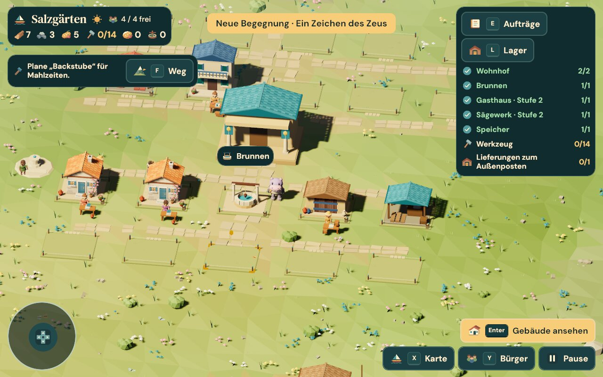
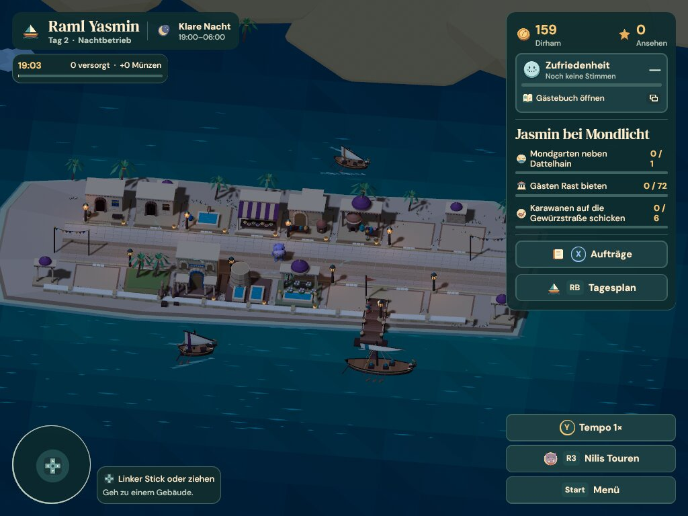
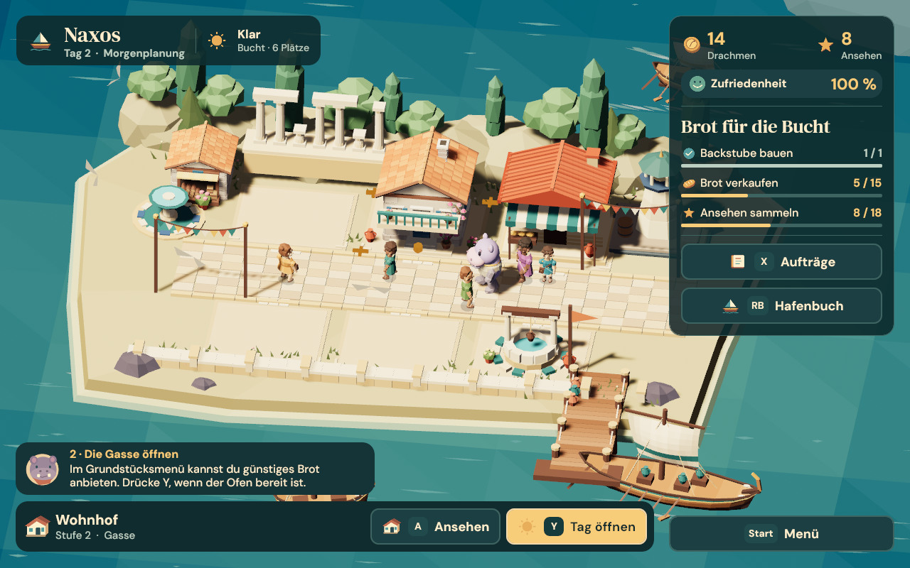
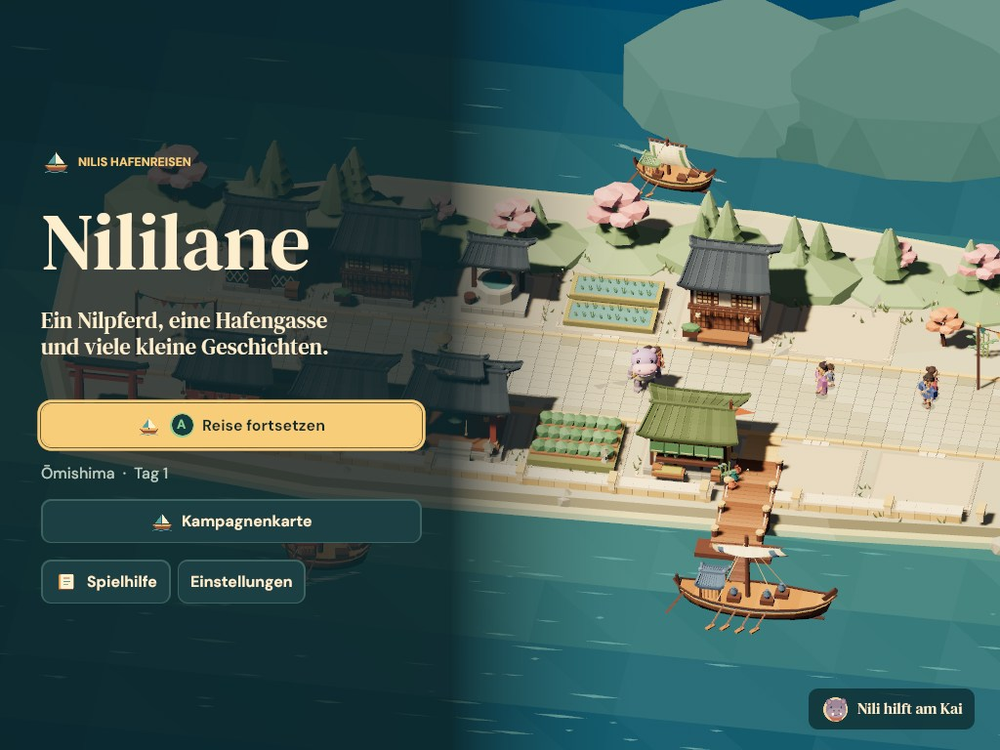
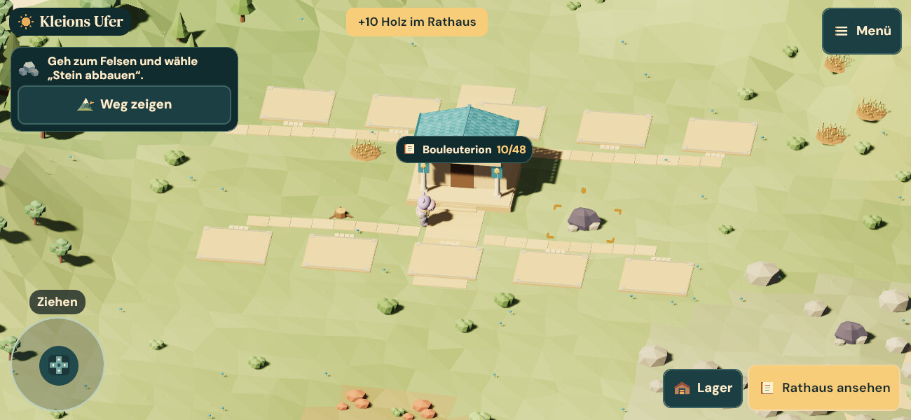
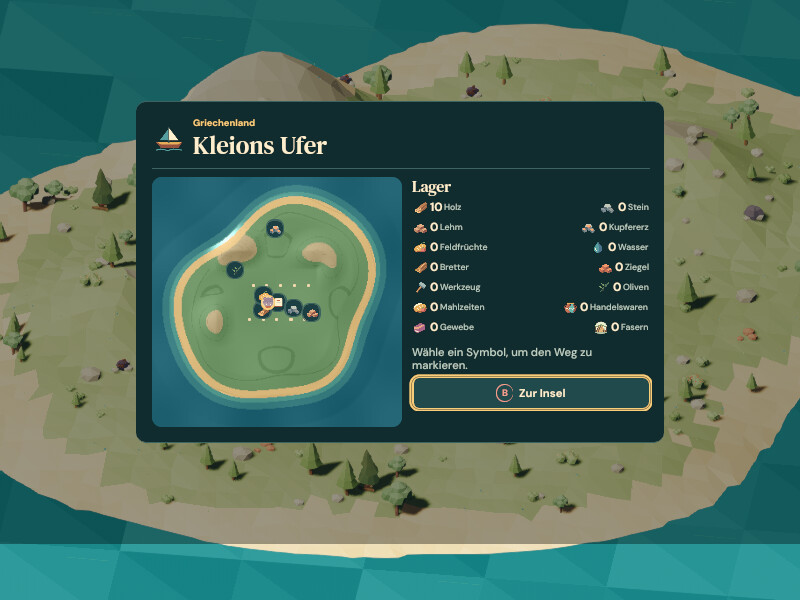
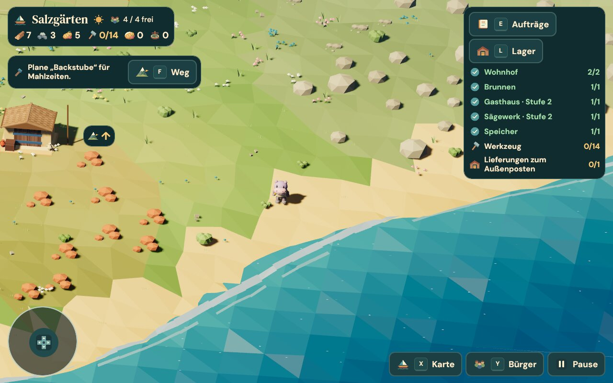
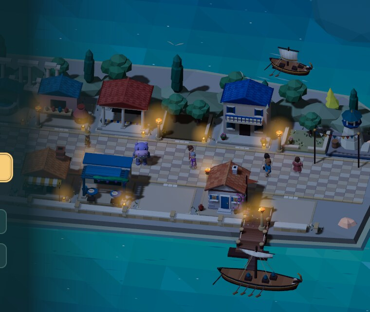
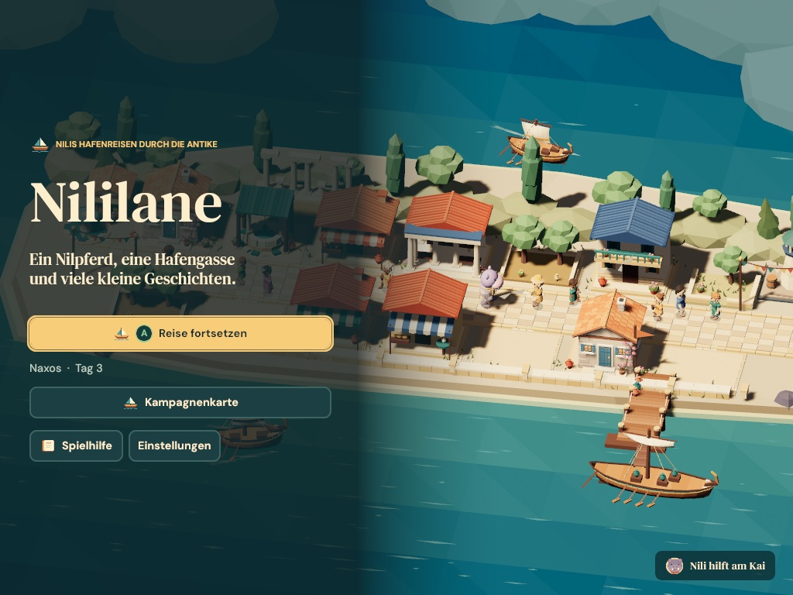

# Nililane

Nililane ist ein 3D-Straßenmanagementspiel in Rust und Bevy. Mit Nili
reist du durch Griechenland, Rom, Japan, die nordischen Häfen und die
Oasenreiche. In der Planung baust du die Gasse und legst Angebote fest.
Während der Schicht steuerst du Nili und versorgst Nachbarn und Reisende.
In der Abenteuerkampagne erkundest du größere Inseln und baust dort eigene
Siedlungen.

## Android-Downloads

**[Handy-APK 3.5.1 für ARM64](https://media.githubusercontent.com/media/bthginfo/Nililane/f71208911b62387aeff661f966a2804ca6948008/Nililane-3.5.1-Handy.apk)** · [SHA-256](https://raw.githubusercontent.com/bthginfo/Nililane/f71208911b62387aeff661f966a2804ca6948008/Nililane-3.5.1-Handy.apk.sha256) · [Handy-Release](https://github.com/bthginfo/Nililane/releases/tag/v3.5.1-phone)

**[Tablet-APK 3.5.1 für ARM64](https://media.githubusercontent.com/media/bthginfo/Nililane/f71208911b62387aeff661f966a2804ca6948008/Nililane-3.5.1.apk)** · [APK für x86_64](https://media.githubusercontent.com/media/bthginfo/Nililane/f71208911b62387aeff661f966a2804ca6948008/Nililane-3.5.1-x86_64.apk) · [Tablet-Release](https://github.com/bthginfo/Nililane/releases/tag/v3.5.1)

[SHA-256 für ARM64](https://raw.githubusercontent.com/bthginfo/Nililane/f71208911b62387aeff661f966a2804ca6948008/Nililane-3.5.1.apk.sha256) · [SHA-256 für x86_64](https://raw.githubusercontent.com/bthginfo/Nililane/f71208911b62387aeff661f966a2804ca6948008/Nililane-3.5.1-x86_64.apk.sha256)









## Auf dem Handy spielen

Die APK installiert **Nililane Handy** als eigene App für ARM64-Smartphones
wie das Samsung Galaxy S24 Ultra. Beide Kampagnen lassen sich im Querformat
spielen. Du kannst die Handy- und Tablet-App nebeneinander installieren.
Jede App führt ihren eigenen Spielstand.

Setz den Daumen auf den Stick unten links und zieh in die gewünschte
Richtung. Wenn du loslässt, bleibt Nili stehen. Unten rechts erscheint
die passende Aktion, etwa **Sammeln**, **Bauen** oder **Hilfe starten**.
Die Aktion lässt sich mit dem zweiten Daumen bedienen.

Über **Menü** erreichst du Aufträge und die Kamera. Je nach Kampagne
findest du dort den Tagesplan und das Gästebuch oder die Inselkarte,
das Lager und die Bürgeraufträge. In langen Fenstern kannst du wischen.

Im Hafen öffnet **Touren** neben **Menü** Nilis Aufträge. Sobald auf
Naxos eine Bitte vom Kai ansteht, kannst du dort auf **Hilfe starten**
tippen. Ab Amorgos wählst du zusätzlich eigene Touren. Tippe neben
dem passenden Abholort und Ziel auf **Starten** und steuere Nili los.



## Auf dem Tablet spielen

Die signierten Pakete benötigen Android 8 oder neuer und Vulkan 1.1.
Lade die passende APK auf dein Tablet und öffne die Datei. Installiere sie
als Update über deine bisherige Version, um deine Hafenreise, deine
Abenteuerinseln und deine Sterne mitzunehmen. Nililane läuft offline und
öffnet sich im Querformat.

Kopple den Xbox-Controller über die Android-Bluetooth-Einstellungen oder
schließe ihn per USB an. Unter **Erste Reise** beginnt der bebilderte
Einstieg auf Naxos. Auf den ersten drei Inseln hält der Spieltag an wichtigen
Stellen an. Mit **A** oder einem Tipp auf die Markierung folgst du der Hilfe.
Mit **B** schließt du den Hinweis. Im Haupt- und Pausenmenü findest du die
**Spielhilfe**. In den **Einstellungen** kannst du die Oberfläche vergrößern
und Musik, Umgebung (Meer, Brandung, Regen) und Klänge getrennt in fünf
Stufen von Aus bis 100 % einstellen.

| Xbox-Controller | Aktion |
| --- | --- |
| Linker Stick | Tagsüber Nili bewegen |
| Steuerkreuz | Menü bedienen oder morgens einen Bauplatz wählen |
| A | Bestätigen oder mit dem Gebäude, der Abholung oder dem Tier in deiner Nähe interagieren |
| B | Zurück, pausieren oder den laufenden Auftrag abbrechen |
| X | Aufträge ansehen |
| Y | Tag starten, das Tempo zwischen 1×, 2× und 4× wechseln oder auf der Kampagnenkarte das Tutorial neu starten |
| RB | Tagesplan mit Gästezahlen, Wetter und Notizen öffnen |
| View (Taste mit zwei Rechtecken) | Gästebuch direkt öffnen |
| Rechten Stick drücken (R3) | Ab Amorgos Nilis Touren öffnen |
| Linken Stick drücken (L3) | In der Abenteuerkampagne das Rohstofflager öffnen |
| Rechter Stick, LT und RT | Kamera schwenken und zoomen |
| LB | Kamera zurücksetzen |
| LB und RB in Fenstern mit Reitern | Durch Tagesplan, Spielhilfe, Garderobe und Kampagnenkarte blättern |
| Start | Pausenmenü öffnen |

Zieh tagsüber das runde Steuerfeld, um Nili zu bewegen. Geh zu einem
Gebäude und tippe auf die helle Aktion, um Vorrat und Bedarf zu sehen.
Für Bauplätze, Preise und Angebote nutzt du morgens die Planung.
Mit der Tastatur bewegst du Nili mit WASD oder den Pfeiltasten. Enter
entspricht A, Escape entspricht B. X, Y, P, Q und E entsprechen X, Y,
Start, LB und RB. N öffnet Nilis Touren. F öffnet das Gästebuch.
Die Tastenhinweise folgen dem zuletzt benutzten Gerät: Controller-Symbole,
Tastaturtasten oder keine Hinweise bei Maus und Touch. Auf Desktop und
Tablet schließt ein Tipp neben ein Fenster dieses Fenster.

## Aufträge in den Häfen

Die ersten beiden Häfen jedes Gebiets haben drei Ziele. Danach wechseln
sich Inseln mit fünf, sechs oder sieben Aufgaben ab. Unter **Aufträge**
siehst du den Fortschritt. Ein Stern markiert im Laden das Angebot, das
gerade für den Handelsauftrag zählt.

Verkaufe zuerst das Grundangebot. Baue den Laden aus und wähle das neue
Produkt morgens aus. Auf späteren Inseln zählen bestimmte Verkäufe erst,
wenn das Produkt das Lieblingsangebot des Gasts ist. Im **Gästebuch**
siehst du die Zufriedenheit der Altersgruppen. Bei einem Umbau führt
**Bauplatz öffnen** direkt zum vorgesehenen Grundstück.

## Abenteuerkampagne

Im Hauptmenü erreichst du die **Abenteuerkampagne**. Auf jeder Insel wartet
ein Rathaus. Geh zu einem Rohstoff, starte den Abbau und bring die Ladung
zum Rathaus. Nili trägt zehn Einheiten einer Sorte. Jede Stufe deines besten
Speichers erlaubt zwei mehr, höchstens zwanzig. Nach dem Abbau bleiben
Stümpfe, Bruchstücke oder abgeerntete Stellen zurück. **Weg anzeigen**
und die Markierungen auf der Inselkarte legen eine türkise Spur zum Ziel.
Du führst Nili selbst entlang der Spur.



- 60 Inseln in fünf Gebieten mit 10 bis 34 Bauplätzen. Nach den zwölf
  Inseln eines Gebiets öffnet sich das nächste.
- Das Rathaus fasst 72 Einheiten Rohstoffe. Ein Speicher bringt
  zunächst 36 weitere Plätze, jeder Ausbau 24. Ist das Lager voll, legen
  Sammler ihre Restfracht vor dem Rathaus ab und sind wieder frei.
  **L3** am Controller oder **L** auf der Tastatur öffnet das Rohstofflager.
  Dort kannst du Vorräte aussortieren und am Rathaus abgelegte Fracht einlagern.
- Du kannst Gebäude und Ausbauten bei leerem Lager planen. Freie Bürger holen
  Baumaterial am Rathaus und legen es auf der Baustelle ab. Nili kann passende
  Fracht direkt aus der Hand ablegen, auch bei vollem Lager. Sobald alle Stapel
  da sind, kann Nili mitbauen. Mit einem größeren Bautrupp geht die Arbeit
  schneller. Höhere Ausbaustufen dauern länger.
- Baue einen Wohnhof und weise Bürger zum Sammeln oder zur Arbeit in
  einer Werkstatt zu. Sammler laufen selbst zum Abbaugebiet und bringen
  ihre Ladung zurück. Mit **Stopp** beendest du einen Auftrag sofort.
  Mitgeführte Fracht bleibt am Abbruchort liegen. Verlässt der letzte
  Bürger eine Werkstatt, pausiert der Arbeitsgang. Nili oder ein neu
  zugeteilter Bürger kann ihn fortsetzen. Ziegel, Werkzeuge und Gewebe
  brauchen länger als Bretter.
- Ab der zweiten Insel kannst du eine fertige **Fracht packen**, sobald Nili
  am Rathaus steht. Alternativ wählst du unter **Lieferungen** die Aktion
  **Bürger schicken**. Der Bürger holt die Waren am Rathaus, liefert sie am
  Außenposten ab und kommt zurück. Spätere Inseln haben bis zu vier Lieferungen
  und mehr Bau- und Ausbauziele.
- Im Reiter **Handwerk** stehen die Meisteraufträge. Stelle zuerst
  die Grundware in der geforderten Werkstatt her. Nach dem Ausbau kannst
  du dort die neue Rezeptur auswählen. Sobald die Ware fertig ist, lässt
  sie sich am Rathaus für den Außenposten packen.
- Auf späteren Inseln schalten Fundstücke und Warenlieferungen Baupläne
  für neue Gebäude oder höhere Ausbaustufen frei.
- Während du die Siedlung aufbaust, treffen Reisende ein und Nachbarn
  bitten um Hilfe. Unter **Aufträge → Begegnungen** kannst du Wege
  markieren. Bei einem Brand holst du Wasser an einer Wasserstelle oder an
  der Küste. Andere Aufträge führen zu einem Wiederaufbau, einem Fest oder
  einem Fundstück für das örtliche Heiligtum.
- Ab der achten Insel jedes Gebiets kannst du mit Nachbarhäfen handeln.
  Packe die Ware am Rathaus und bring sie zum Handelsschiff. Für
  Handelsmarken gibt es seltene Baustoffe und einen regionalen Sonderbauplan.
  Gekaufte Baustoffe trägt Nili zum Rathaus oder direkt zur Baustelle.
  Die Agora, das Amphitheater, der Pagodengarten, die Thinghalle und der
  Palast der Sterne haben jeweils sechs sichtbare Stufen.
- Tageslicht, Laternen und Musik wechseln während des Spiels. Du kannst
  jederzeit weiter sammeln und bauen.
- Nach dem letzten Inselziel zeigt die **Siedlungsbilanz** unter anderem
  Einwohner, Bauplätze und Vorräte. Bleib zum Weiterbauen auf der Insel
  oder reise zur nächsten. Die Bilanz kannst du jederzeit erneut öffnen.
- Die Einführung lässt sich auf der Abenteuerkarte erneut starten.
  Die Siedlungen und die Hafenreisen haben eigene Spielstände. Sterne und
  die Garderobe gehören in beiden Modi zu Nili.
- 25 neue Teile ergänzen die Garderobe auf insgesamt 68 Stücke.
  Das Schloss zeigt die passende Insel. Nach dem Abschluss kannst du das
  Teil mit Sternen kaufen.

| Im Abenteuer | Xbox-Controller und Touch |
| --- | --- |
| Bewegen | Linker Stick, Steuerkreuz oder den Touch-Stick ziehen |
| Vor Ort sammeln, bauen oder mit einem Gebäude interagieren | A, auf das Objekt oder die goldene Aktion tippen |
| Rohstoffdetails und Bürgerzuweisung | Rechten Stick drücken oder auf „Details“ tippen |
| Inselkarte und Lager | X oder „Karte“ |
| Bürgeraufträge | Y oder „Bürger“ |
| Aufträge und Siedlungsbilanz | RB oder die gleichnamige Schaltfläche |
| Weg in der Einführung ein- oder ausblenden | View oder „Weg anzeigen“ |
| Pause | Start, B oder „Pause“ |

## Neu in 3.6.0

Die Downloads oben enthalten noch Version 3.5.1. Version 3.6.0 lässt sich
aus dem Quellcode bauen.

**Grafik**

- **Lebendiges Meer.** Jede Facette des Wassers bewegt sich mit der Dünung,
  fängt das Licht und glitzert. Sturm, Regen und Hitze verändern Wellengang
  und Glanz. Nachts bleibt das Meer dunkel und spiegelt kühles Mondlicht.
- **Küsten mit Brandung.** Um die Abenteuerinseln liegt türkises Flachwasser
  über dem Sand, dahinter tiefes Blau. Zwei Gischtbänder folgen der Küste.
- **Wiesen statt Rasenteppich.** Das Gras wechselt zwischen satten Senken und
  sonnigen Hängen und wird um die Siedlung und entlang der Wege ausgetreten.
  Steinplatten bilden die Wege. Freie Bauplätze sind mit Pflöcken und Schnur
  abgesteckt. Wildblumen, Grasbüschel, Kiesel und Schmetterlinge beleben die
  Wiesen.
- **Licht und Tiefe.** Laternen, Feuerschalen und erleuchtete Türen bekommen
  nachts einen warmen Lichthof. Das Rathaus leuchtet in der Nacht. Gebäude
  stehen in einem weichen Kontaktschatten, ein leichter Dunst legt sich über
  das ferne Wasser. Neue Gebäude feiern ihre Fertigstellung mit Konfetti.
- **Leben auf den Inseln.** Möwen kreisen über der Küste. Nachts fällt warmes
  Licht aus den Türen der Siedlung, und Glühwürmchen tanzen über der Wiese.
  Eine Erzader glänzt golden. Ist eine Insel geschafft, steigt über dem
  Rathaus ein Feuerwerk auf.





**Abenteuerkampagne**

- **Der nächste Schritt.** Ab der zweiten Insel zeigt dir eine Zeile immer,
  was als Nächstes zu tun ist, mit **Weg** zur Markierung. Die Vorratsleiste
  zeigt genau die Waren, die deine Ziele, Baustellen und Lieferungen brauchen.
- **Fortschritt wird gefeiert.** Meldungen wie „Inselziel 4/7“, „+2 Bürger
  ziehen ein“ oder „Nur noch 12 Werkzeug“ begleiten den Aufbau.
- **Weniger Leerlauf.** Speicher machen Nili stärker: bis zu 20 Waren pro
  Gang. Hat Nili noch Platz, führt die Markierung zum nächsten Baum oder Stein
  derselben Sorte. In einer laufenden Werkstatt kann Nili **mitarbeiten**,
  dann geht der Arbeitsgang schneller.
- **Begegnungen mit Rhythmus.** Besucher kommen passend zu deinem Fortschritt,
  kehren später mit neuen Geschichten zurück, und ein unbeachtetes Feuer
  erlischt von selbst.
- **Jede Insel anders.** Wald, Steinbruch und Felder liegen auf jeder Insel
  woanders, eines nah an der Siedlung, eines weit draußen. Auch die Hügel
  wandern. Ab der zweiten Insel hat jede Insel eine Besonderheit, etwa
  **Reiche Wälder**, **Erzader**, **Günstiger Wind**, **Festlaune**,
  **Fleißige Hände** oder **Fruchtbarer Boden**. Du findest sie im
  Inselbrief und auf der Karte.
- **Markt im Handelshafen.** Für Handelsmarken kaufst du Ziegel, Werkzeug
  oder Waren der Region. Nili trägt sie zur Baustelle oder zum Rathaus. Das
  Wahrzeichen beschleunigt Werkstätten deutlich stärker und weiter.
- **Mehr Abwechslung.** Späte Inseln verlangen die Spezialware ihres Gebiets.
  Die ersten Oasen haben eigene Sonderbauten.
- **Spürbarer Fortschritt.** Wächst ein Vorrat, leuchtet seine Zahl kurz
  golden auf. Ist die Insel geschafft, erklingt eine Fanfare, bevor die
  Bilanz erscheint.
- **Korrekturen.** Bürger bleiben nicht mehr in fertigen Gebäuden stecken.
  Baustellen nennen den echten Grund, wenn es nicht weitergeht. Ein
  beschädigter Spielstand löscht nicht mehr alle Inseln.

**Hafenreisen**

- **Preise mit Vorschau.** Jede Preiskarte zeigt, wie viele Verkäufe und
  Münzen der Preis morgen bringt und wie viele Gäste ohne Kauf gehen. Ein
  Stern markiert den besten Preis.
- **Opfergabe und Herold.** Am Heiligtum bringt Nili einmal am Tag eine
  Opfergabe, am Forum ruft sie den Herold. Dann kommen zwei Gäste mehr, mit
  einem Olivenhain oder Speicher daneben drei.
- **Tagesereignisse.** Handelsschiffe, Hochzeiten, Schulausflüge und Pilger
  bringen an manchen Tagen zusätzliche Gäste. Der Tagesplan kündigt sie an.
  Festtage werden in Japan zum Matsuri und im Norden zum Thing. Bei
  Sandsturm haben Fährgäste in den Oasen mehr Geld dabei.
- **Serien und Rekorde.** Je fünf zufriedene Gäste in Folge bringen +1
  Ansehen. „Ziel erreicht“ erscheint sofort, und der Abendbericht zeigt neue
  Tagesrekorde. Sobald dir drei Sterne sicher sind, feiert eine Meldung den
  Moment.
- **Mehr zu tun an langen Tagen.** Das Tempo reicht bis 4×, und auf großen
  Inseln darf Nili mehr Touren laufen. Schnelle Hilfe bei Zwischenfällen
  bringt +3 Münzen und +2 Ansehen. Das Tagesextra wächst mit deinem Hafen.
- **Korrekturen.** Begleitete Gäste kaufen jetzt wirklich ein. Schattentouren
  wirken auch in Gartenhof und Mondgarten. Die Festhalle braucht zwei
  Räucherfische und hat neben einer Räucherei einen Platz mehr. Ein
  beschädigter Hafen löscht nicht mehr die ganze Kampagne; eine unlesbare
  Datei wird vorher als `.bak` gesichert. Die Fähre legt erst ab, wenn ihr
  letzter Fahrgast an Land ist.

**Bedienung**

- Schaltflächen wachsen beim Darüberfahren, federn beim Drücken und rütteln
  kurz, wenn eine Aktion gerade nicht möglich ist. Fenster öffnen sich sanft,
  Szenenwechsel werden überblendet.
- Hinweise stehen mittig. Fehler erscheinen in Rostrot.
- Die Abendabrechnung zählt die Werte hoch, und die Sterne leuchten
  nacheinander mit einem Glockenklang auf. Erfüllte Aufträge melden sich mit
  Häkchen und Klang.
- Neue, leise Klänge für die Auswahl, Sterne und erfüllte Aufträge. Gleiche
  Klänge variieren leicht in der Tonhöhe. Bei Sternen und erreichten Zielen
  wird die Musik kurz leiser.
- Musik, Umgebung und Klänge haben je fünf Lautstärkestufen, einstellbar mit
  Steuerkreuz, Pfeiltasten oder per Tipp auf − und +. Ausgeschaltete Musik
  blendet sanft aus.
- Beim Start gleitet das Hauptmenü Eintrag für Eintrag ins Bild.
- Aufgeräumtes HUD: Im Abenteuer stehen offene Ziele oben, erledigte werden zu
  einer Zeile zusammengefasst, und „Aufträge“ und „Lager“ teilen sich eine
  Reihe. Im Hafen bleibt die Zufriedenheitskarte schlank, bis die ersten Gäste
  ihre Stimme abgeben, und Nilis Tipps verdecken die Ziele nicht mehr.

## Neu in 2.7.0

- **Hauptreise und Bonusroute.** Nach zwölf geschafften Häfen öffnet sich
  das nächste Gebiet. Die zwölf Bonusinseln je Gebiet haben eigene Aufträge
  und weitere Gebäude. Du kannst zwischen den Routen wechseln und laufende
  Häfen später fortsetzen.
- **Oasenreiche.** 24 neue Orte mit Dattelhainen, Gewürzbasaren, Qanats und
  Karawansereien. Geh mit Nili zur Karawanserei, um Datteln und freies
  Wasser zur Nachbaroase zu schicken. Die Gewürzstraße braucht zusätzlich
  Gewürze und einen ausgebauten Qanat in der Nähe.
- **Vorräte direkt über dem Gebäude.** Wenn Nili am Eingang steht, siehst
  du den verbliebenen und den für die Schicht bereitgestellten Vorrat.
  Kurze Touren bleiben bis kurz vor Schichtende möglich.
- **Fünfzehn Nachtinseln.** Nachtmärkte öffnen von 19:00 bis 06:00 Uhr und
  ziehen Gäste mit eigenen Wünschen an. Öllampen, Feuerschalen,
  Papierlaternen, Fackeln und bronzene Leuchten begleiten die Nacht.
  Große Tageshäfen bleiben bis 21:30 Uhr geöffnet.
- **Gebäude und Aufgaben.** Alle sechs Ausbaustufen wurden überprüft.
  Die vier früheren Gebiete erhalten zusammen zwölf neue Bauten, etwa
  Imkerei, Schreibstube, Seidenweberei und Signalfeuer. Gerüst und Staub
  begleiten den Wechsel der Gebäudestufen. Die Oasen ergänzen zehn eigene
  Gebäudetypen, drei Kleidungsstücke und 24 Musikstücke mit Abendfassungen.

## Neu in 2.6.0

- **Japan** schaltet sich nach dem Rom-Finale frei. Brunnen und Reisfelder liefern
  mehr Reis für die Küchen, Teegärten versorgen Teehäuser und schaffen Platz
  am Tempel. Geh tagsüber mit Nili zum Tempel und läute mit **A** oder einem
  Tipp auf die Glocke. Zusätzliche Pilger kommen zum kostenlosen Gebet. Eine
  Lampionwerkstatt direkt nebenan bringt beim Läuten einen weiteren Gast.
- **Nordische Häfen** öffnen sich nach Awajishima. Fischerhütten und Holzplätze
  versorgen die Räuchereien, die wiederum mehr Plätze in der Festhalle ermöglichen.
  Am Bootshaus belädst du Schiffe mit Räucherfisch für den Inselhandel oder
  ab Stufe 2 für den Fernhandel. Bei Sturm kann die Rückkehr warten. Den Erlös
  erhältst du morgens, wenn das Schiff zurückkommt.
- Beide Reisen bringen eigene 3D-Landschaften, Bauten mit sechs sichtbaren
  Stufen, Fähren, Einwohner und 48 neue Hafenstücke mit je einer Abendfassung.
  Die Spielhilfe und die ersten Häfen zeigen die neuen Abläufe mit Bildern.
- In der Garderobe stehen acht neue Stücke für Japan und acht für den Norden.
  Unter dem Schloss steht der Hafen, dessen Abschluss den Kauf mit Sternen
  freischaltet.

| Gebiet | Beispiel für eine Produktionskette |
| --- | --- |
| Griechenland | Oliven und Wasser → Ölpresse → Olivenöl für die Küstenwache |
| Rom | Getreide → Mühle → Mehl für Backstube und Wachstation |
| Japan | Bambus und Wasser → Papierwerkstatt → Papier für Wegstation und Bauplanaufträge |
| Norden | Bürger in einer Fischerhütte am Küstenbauplatz → Fangfahrt → Fisch für Räucherei und Festhalle |
| Oasenreiche | Qanatwasser, Datteln und Safran → Parfümerie → Duftöl für die Karawane |

## Neu in 2.5.2

- Alle 48 Häfen haben neu eingespielte Instrumentalstücke mit eigener
  Melodie, Begleitung und ruhigerer Abendfassung. Saiten, Holzbläser und
  leise Perkussion geben der Ägäis und Rom unterschiedliche Klangfarben.
  Bei Zwischenfällen wird die Musik leiser, damit man den Hinweis hört.
- Ein Tipp auf das für **Nili hilft** markierte Gebäude startet den Auftrag.
  Anschließend führst du Nili selbst zum Abholort und zur Übergabe.

## Neu in 2.5.1

Im geöffneten Tagesplan stehen oben die Altersgruppen für den ganzen Tag.
Darunter siehst du, wie viele Gäste aus der Gasse und von der Fähre noch kommen.

## Neu in 2.5.0

- **Mehr Platz für Nili.** Die Gasse ist breiter. Tagsüber steuerst du Nili
  frei und gehst zum Gebäude, das du untersuchen möchtest. Die Uhr läuft
  beim Abholen, Tragen und Abliefern weiter. Auf großen Inseln dauern die
  Tage länger und es kommen mehr Fährgäste. Du kannst mehrmals Gäste begleiten.
- **Tagesplan und Beobachtungen.** Die Übersicht zeigt die erwarteten
  Kinder, Erwachsenen und älteren Gäste. In beiden Kampagnen kommen Kinder
  ab dem dritten Hafen und ältere Gäste ab dem fünften dazu. Wohnhöfe und
  Villen zeigen ihre Bewohner. Am Anfang eines Hafens erklären Bildkarten
  die neu hinzugekommenen Aktionen. Unter **Notizen** stehen die Wünsche und Rückmeldungen des
  vergangenen Markttags.
- **Preis und Angebot am selben Ort.** Für Backstuben, Tavernen und Töpfereien
  zeigt jede Spezialität, für wen sie gedacht ist und wie viele Münzen bei
  passenden Verkäufen zu erwarten sind. Gebäude haben sechs Stufen mit
  sichtbaren Ausbauten. Läden erhalten dabei zusätzliche Spezialitäten.
- **Mehr Wege zur Versorgung.** Brunnen liefern Wasser, Haine Oliven und
  Speicher Vorräte. Kräutergärten versorgen benachbarte Küchen. Ihre
  Reichweite wächst ab Stufe 3. Backstuben, Tavernen und Töpfereien haben
  eigene Silhouetten.
- **Abwechslung auf der Gasse.** Nili kann Laub oder Unrat aufheben und
  Katzen oder Hunde streicheln. Dazu kommen Ofenbrände, lose Kisten,
  zerbrochene Krüge, lose Sonnensegel und verirrte Reisegruppen. Optionale
  Tagesaufträge und ein Anteil am Handelsumsatz füllen die Reisekasse.
- **Himmel, Wasser und Musik.** Der Tagesplan zeigt drei Wetterabschnitte.
  Wolken, Regen und Sturm verändern Licht, Meer und Schiffe. Jeder der
  48 Häfen hat ein eigenes Thema mit Abendfassung. Bei Zwischenfällen
  erklingt ein zusätzliches Motiv.
- **Nilis Garderobe.** Sterne kannst du für 24 Gewänder, Hüte und
  Accessoires ausgeben. Nili kann je ein Stück davon kombinieren.


## Neu in 2.3.2

- Die Kamera im Startmenü steht ruhig. Android glättet die Kanten der
  3D-Szene, die Bildausgabe ist mit dem Display synchronisiert, und Schaum
  und Kielwasser zeichnen sich auf getrennten Ebenen ab.
- Mit **Tutorial neu starten** oder **Y** auf der Kampagnenkarte wiederholst
  du die Übungen auf Naxos, Amorgos und Delos. Die Übungsreise speichert
  separat. Über **Übung beenden** gelangst du zurück zur Kampagnenkarte.
  Dein bisheriger Hafen und deine Sterne bleiben erhalten.

## Neu in 2.3.1

Die Fähre liegt mit Abstand vor dem Steg. Ein hölzerner Landgang führt
an Bord und bewegt sich mit dem Schiff. Am Liegeplatz ist das Segel
eingeholt, beim Ablegen entfaltet es sich. Die Titelkamera zeigt die Fähre
auch im 4:3-Format vollständig.



## Neu in 2.3

- **Naxos** zeigt den ersten Bauplatz, die Preise, den Tagesstart, die
  anlegende Fähre und die ersten Gästestimmen.
- **Amorgos** führt vom Brunnen zur Backstube. **Delos** zeigt den Platz
  für die Töpferei, die Nachschubtour und den ersten Ausbau.
- Eine helle Markierung zeigt den passenden Ort. Daneben steht ein kurzer
  Hinweis mit einer Aktion. Bei Ereignissen während des Tages pausiert die Uhr.
- Schilder und eine Punktspur zeigen Nilis Abholort und Ziel. Er hebt Kisten,
  füllt und gießt Krüge, winkt Gästen, fächert mit Zweigen und räumt Treibgut.
  Nach der Arbeit zeigt ein Symbol, was am Ziel angekommen ist.
- Hinweise, Aufträge, Gästestimmen und Hafengeschichten sind sprachlich
  überarbeitet. Bei Läden heißt es „Ausverkauft“, bei Betten und Plätzen
  „Belegt“.
- Die Ausbauvorschau markiert knappe Wasserversorgung. Die Kampagnenprüfung
  hat alle 48 Häfen mit drei Sternen abgeschlossen und den Fortschritt
  nach jedem Hafen wieder geladen.


## Neu in 2.2

- Nili markiert den nächsten Schritt auf der Insel. Auf Naxos zeigen Bilder
  die Reihenfolge vom ersten Bauplatz bis zum Tagesstart. Auf Amorgos führt
  Nili vom Brunnen zur ersten Wasserlieferung.
- Die Baukarten zeigen Kosten und Ertrag. In der Preiswahl siehst du für jede
  Stufe, wie viele der erwarteten Gäste genug Geld haben.
- Sprechblasen und Schilder zeigen leere Auslagen, offene Bitten vom Kai und
  mögliche Ziele für Nilis Touren. Die Aufträge erhalten bei Fortschritt
  einen aktualisierten Balken und bei Erfüllung ein Häkchen.
- Die Spielhilfe erklärt Steuerung und Abläufe mit Symbolen und kurzen
  Sätzen. Die Begrüßungen und Tipps aller 48 Häfen sind überarbeitet.


## Neu in 2.1

- Über Gästen erscheinen Gesichter, das Warensymbol und ein kurzer Hinweis.
  Tippe eine Sprechblase an, um die Rückmeldung im Gästebuch zu öffnen.
- Die Zufriedenheitskarte zeigt die Anzahl erfüllter Wünsche und die letzte
  Stimme. Im Gästebuch lassen sich Nachbarn und Fährgäste vergleichen und
  Preisprobleme, leere Auslagen, lange Wege und fehlende Angebote filtern.
- Das Gästebuch führt zum betroffenen Laden oder schlägt morgens einen
  erreichbaren Bauplatz vor. Im geöffneten Hafen vergleicht die Vorratsseite
  den restlichen Bestand mit den noch anstehenden Besuchen.
- Nach der Abrechnung bleiben die Gästestimmen für die Morgenplanung erhalten.


## Neu in 2.0

- **Nilis Hafenrunden.** Schick Nili zum Wasserholen, zur Eilfracht, als
  Gästelotse, auf Schattentour oder nach Unwetter zum Treibgutbergen. Wähle
  das Ziel auf der Insel. Nili läuft hin, lädt auf und liefert ab.
- **Neue Aufträge.** Plane Nachschub und Fährbesuche gezielt ein. Je nach Hafen
  zählen bestimmte Touren, verschiedene erledigte Aufgaben, ein guter Fährtag
  oder die Zufriedenheit bei ausreichenden Rückmeldungen.
- **Verschiedene Küsten.** 6 bis 18 Bauplätze auf Buchten, Landzungen,
  Terrassenhäfen und Lagunen. Die Gassen- und Promenadenseiten sind je nach
  Hafen verschieden lang.
- **Sichtbare Ausbauten.** Von Außenöfen und Dachgärten bis zu Badegalerien und
  neuen Aquäduktbögen. Ein kurzes Gerüst mit Staub und Hammerschlägen zeigt
  Neubauten und Ausbauten direkt auf dem Grundstück.
- **Lebendige Gassen.** Griechische und römische Gäste tragen unterschiedliche
  Kleidung, gehen mit animierten Schritten und folgen dem Weg zum Laden.
  Im Gästebuch sagen die Gäste, was sie gefunden oder vermisst haben.

## Die Reise

- **Griechenland** beginnt in Naxos und endet am Hafenrat von Korinth. In
  24 Kapiteln kommen Speicher, Ölpressen und Heiligtümer zu den ersten
  Werkstätten, Höfen und Tavernen hinzu.
- **Rom** schaltet sich nach Griechenland frei. In 24 weiteren Kapiteln
  verbinden Aquädukte, Thermen, Foren und Villen die Gassen von Ostia bis
  Rom. Thermen profitieren von Aquädukten. Ein Forum erweitert die
  Reichweite der Fährgäste, und Villen bringen wohlhabendere Nachbarn.
- **Japan** führt von Tomonoura bis zum Fest auf Awajishima.
- **Nordische Häfen** führen von Borg auf den Lofoten bis nach Hedeby.
- Die 30 Gebäudetypen lassen sich bis Stufe 6 ausbauen. Für Läden stehen
  drei Preise zur Wahl. Die Ausbauvorschau benennt die sichtbare Erweiterung
  und zeigt, wie sich Wasser, Vorräte und Bewohnerzahlen verändern.
- Im Hafenplan stehen Nachfrage, Vorräte, Zufriedenheit und die Vorhersage
  für drei Tage. Wind, Regen und Sturm beeinflussen die See, den
  Fährverkehr und die Wasserreserven. Mit dem Hafenplan kannst du
  Wasser holen, zusätzliche Fährgäste einladen oder Nachbarn bevorzugen.
- Am Hafen warten drei Aufträge. Ein zügiger Abschluss und Bitten vom Kai bringen
  Zusatzsterne. Nach dem Abschluss kannst du bleiben, weiterreisen
  oder einen Hafen für mehr Sterne erneut besuchen.
- Bauentscheidungen, laufende Tage und Sternrekorde werden lokal gespeichert.
  Bei Normaltempo ergeben die Referenzpartien rund acht Stunden
  geöffneter Gasse in Japan und gut neuneinhalb Stunden in den nordischen
  Häfen. Planung, Tempo und Wiederholungen beeinflussen die Spielzeit.

## Aus dem Quellcode starten

Mit Rust Stable und auf Linux mit Vulkan, X11, `libudev-dev` und
`libasound2-dev`.

```sh
cargo run --locked
cargo test --locked
```

Zum Paketieren sind JDK 17 oder neuer, Python 3, SDK Platform 36, Build Tools
36.0.0 und NDK r28c erforderlich. Die SDK-Installation muss über
`ANDROID_HOME` oder `ANDROID_SDK_ROOT` erreichbar sein.

```sh
rustup target add aarch64-linux-android x86_64-linux-android
tools/build-android.sh
NILILANE_VARIANT=phone NILILANE_ABIS=arm64-v8a tools/build-android.sh
```

Die APKs liegen in `build/android/`. Der erste Aufruf baut die Tablet-App,
der zweite die Handy-App. Ohne Signaturparameter sind beide APKs lokal
signiert. Für ein Paket mit eigenem Veröffentlichungszertifikat
verwende `NILILANE_KEYSTORE` und `NILILANE_KEY_PASSWORD_FILE` sowie bei
Bedarf `NILILANE_KEY_ALIAS`. Updates brauchen die jeweilige Paket-ID und
denselben Signaturschlüssel.

[Asset-Herkunft](assets/QUELLEN.md) · [Tests und Spielreview](docs/Abnahme.md)
