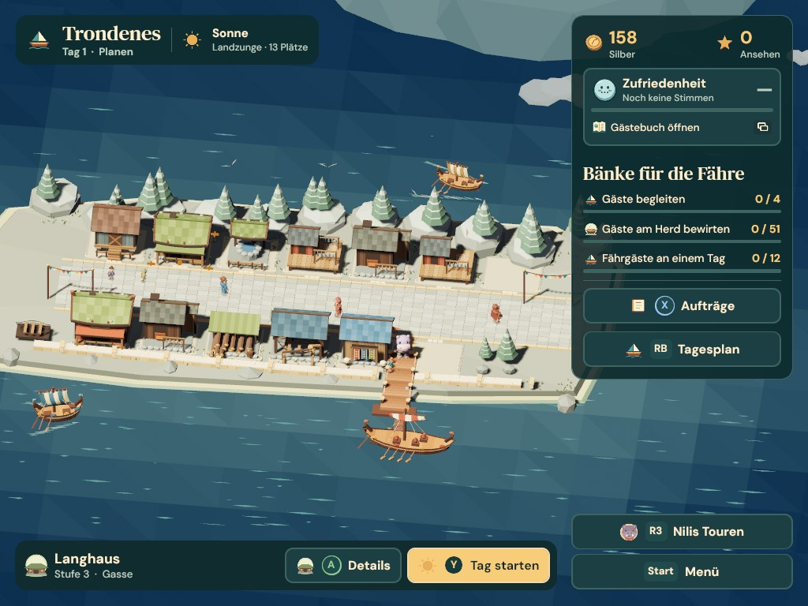
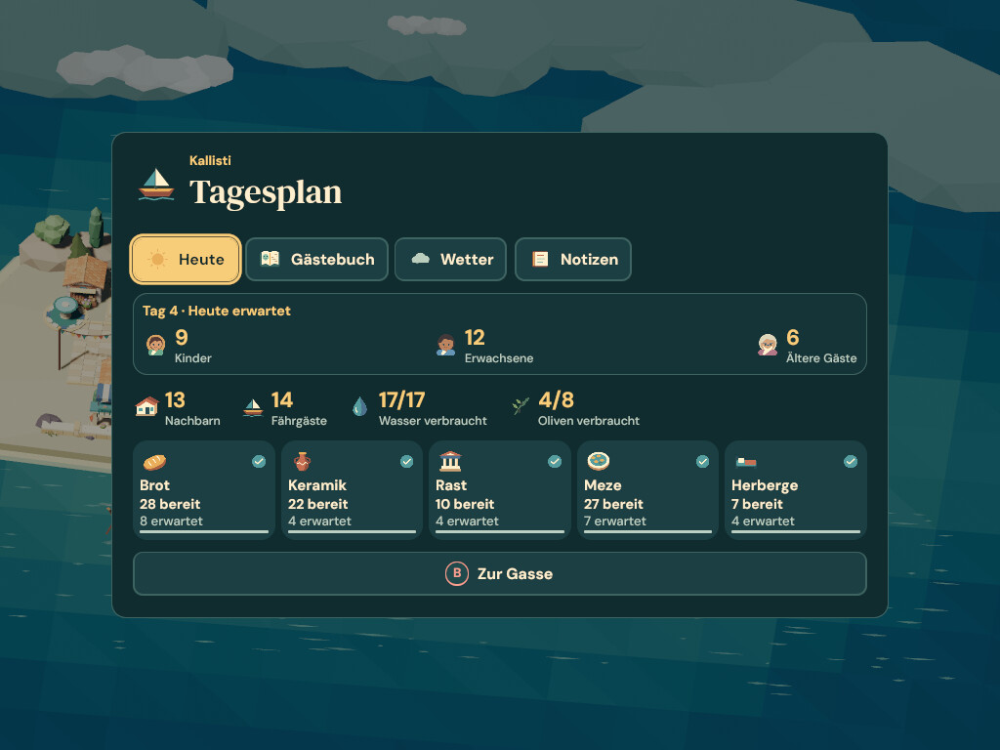
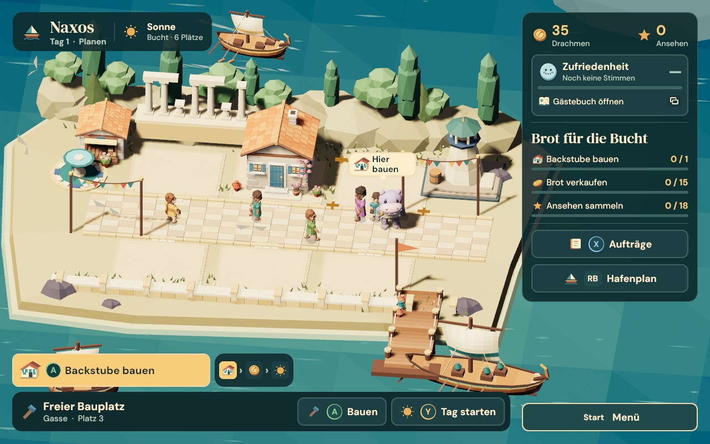

# Nililane 2.6.0

Nililane ist ein 3D-Straßenmanagementspiel in Rust und Bevy. Mit Nili
reist du durch das antike Griechenland, das antike Rom, das feudale Japan
und die nordischen Häfen der Wikingerzeit. Jede Reise hat 24 Kapitel.
Du planst morgens die Gasse, versorgst Nachbarn und Fährgäste und steuerst
Nili tagsüber bei seinen Aufgaben.

**[Android-APK für ARM64-Tablets](https://raw.githubusercontent.com/bthginfo/Nililane/e105d3533c082a6634dc7f1442792332b5a722d9/Nililane-2.6.0.apk)** · [APK für x86_64](https://raw.githubusercontent.com/bthginfo/Nililane/e105d3533c082a6634dc7f1442792332b5a722d9/Nililane-2.6.0-x86_64.apk) · [Veröffentlichung](https://github.com/bthginfo/Nililane/releases/tag/v2.6.0)

[SHA-256 für ARM64](https://raw.githubusercontent.com/bthginfo/Nililane/e105d3533c082a6634dc7f1442792332b5a722d9/Nililane-2.6.0.apk.sha256) · [SHA-256 für x86_64](https://raw.githubusercontent.com/bthginfo/Nililane/e105d3533c082a6634dc7f1442792332b5a722d9/Nililane-2.6.0-x86_64.apk.sha256)




## Auf dem Tablet spielen

Die signierten Pakete benötigen Android 8 oder neuer und Vulkan 1.1.
Wähle das Paket für deinen Prozessor und öffne es auf dem Tablet. Installiere das Update über deine bisherige Version, um deine laufende
Gasse und die Sternrekorde mitzunehmen. Nililane läuft offline und öffnet sich im Querformat.

Kopple den Xbox-Controller über die Android-Bluetooth-Einstellungen oder
schließe ihn per USB an. Unter **Erste Reise** beginnt der bebilderte
Einstieg auf Naxos. Auf den ersten drei Inseln hält der Spieltag an wichtigen
Stellen an. Mit **A** oder einem Tipp auf die Markierung folgst du der Hilfe.
Mit **B** schließt du den Hinweis. Im Haupt- und Pausenmenü findest du die
**Spielhilfe**. In den **Einstellungen** kannst du die Oberfläche vergrößern
sowie Musik und Spielklänge separat schalten.

| Xbox-Controller | Aktion |
| --- | --- |
| Linker Stick | Tagsüber Nili bewegen |
| Steuerkreuz | Menü bedienen oder morgens einen Bauplatz wählen |
| A | Bestätigen oder mit dem Gebäude, der Abholung oder dem Tier in deiner Nähe interagieren |
| B | Zurück, pausieren oder den laufenden Auftrag abbrechen |
| X | Aufträge ansehen |
| Y | Tag starten, das Tempo wechseln oder auf der Kampagnenkarte das Tutorial neu starten |
| RB | Tagesplan mit Gästezahlen, Wetter und Notizen öffnen |
| View (Taste mit zwei Rechtecken) | Gästebuch direkt öffnen |
| Rechten Stick drücken (R3) | Ab Amorgos Nilis Touren öffnen |
| Rechter Stick, LT und RT | Kamera schwenken und zoomen |
| LB | Kamera zurücksetzen |
| Start | Pausenmenü öffnen |

Zieh tagsüber das runde Steuerfeld, um Nili zu bewegen. Geh zu einem
Gebäude und tippe auf die helle Aktion, um Vorrat und Bedarf zu sehen.
Für Bauplätze, Preise und Angebote nutzt du morgens die Planung.
Mit der Tastatur bewegst du Nili mit WASD oder den Pfeiltasten. Enter
entspricht A, Escape entspricht B. X, Y, P, Q und E entsprechen X, Y,
Start, LB und RB. N öffnet Nilis Touren. F öffnet das Gästebuch.

## Neu in 2.6.0

- **Japan** schaltet sich nach dem Rom-Finale frei. Brunnen und Reisfelder liefern
  mehr Reis für die Küchen, Teegärten versorgen Teehäuser und schaffen Platz
  am Tempel. Geh tagsüber mit Nili zum Tempel und läute mit **A** oder einem
  Tipp auf die Glocke. Zusätzliche Pilger kommen zum kostenlosen Gebet. Eine
  Lampionwerkstatt direkt nebenan bringt beim Läuten einen weiteren Gast.
- **Nordische Häfen** öffnen sich nach Awajishima. Fischerhütten und Holzplätze
  versorgen die Räuchereien, die wiederum mehr Plätze in der Festhalle ermöglichen.
  Am Bootshaus belädst du Schiffe mit Räucherfisch für den Inselhandel oder
  ab Stufe 2 für den Fernhandel. Bei Sturm kann die Rückkehr warten. Den Erlös
  erhältst du morgens, wenn das Schiff zurückkommt.
- Beide Reisen bringen eigene 3D-Landschaften, Bauten mit sechs sichtbaren
  Stufen, Fähren, Einwohner und 48 neue Hafenstücke mit je einer Abendfassung.
  Die Spielhilfe und die ersten Häfen zeigen die neuen Abläufe mit Bildern.
- In der Garderobe stehen acht neue Stücke für Japan und acht für den Norden.
  Unter dem Schloss steht der Hafen, dessen Abschluss den Kauf mit Sternen
  freischaltet.

## Neu in 2.5.2

- Alle 48 Häfen haben neu eingespielte Instrumentalstücke mit eigener
  Melodie, Begleitung und ruhigerer Abendfassung. Saiten, Holzbläser und
  leise Perkussion geben der Ägäis und Rom unterschiedliche Klangfarben.
  Bei Zwischenfällen wird die Musik leiser, damit man den Hinweis hört.
- Ein Tipp auf das für **Nili hilft** markierte Gebäude startet den Auftrag.
  Anschließend führst du Nili selbst zum Abholort und zur Übergabe.

## Neu in 2.5.1

Im geöffneten Tagesplan stehen oben die Altersgruppen für den ganzen Tag.
Darunter siehst du, wie viele Gäste aus der Gasse und von der Fähre noch kommen.

## Neu in 2.5.0

- **Mehr Platz für Nili.** Die Gasse ist breiter. Tagsüber steuerst du Nili
  frei und gehst zum Gebäude, das du untersuchen möchtest. Die Uhr läuft
  beim Abholen, Tragen und Abliefern weiter. Auf großen Inseln dauern die
  Tage länger und es kommen mehr Fährgäste. Du kannst mehrmals Gäste begleiten.
- **Tagesplan und Beobachtungen.** Die Übersicht zeigt die erwarteten
  Kinder, Erwachsenen und älteren Gäste. In beiden Kampagnen kommen Kinder
  ab dem dritten Hafen und ältere Gäste ab dem fünften dazu. Wohnhöfe und
  Villen zeigen ihre Bewohner. Am Anfang eines Hafens erklären Bildkarten
  die neu hinzugekommenen Aktionen. Unter **Notizen** stehen die Wünsche und Rückmeldungen des
  vergangenen Markttags.
- **Preis und Angebot am selben Ort.** Für Backstuben, Tavernen und Töpfereien
  zeigt jede Spezialität, für wen sie gedacht ist und wie viele Münzen bei
  passenden Verkäufen zu erwarten sind. Gebäude haben sechs Stufen mit
  sichtbaren Ausbauten. Läden erhalten dabei zusätzliche Spezialitäten.
- **Mehr Wege zur Versorgung.** Brunnen liefern Wasser, Haine Oliven und
  Speicher Vorräte. Kräutergärten versorgen benachbarte Küchen. Ihre
  Reichweite wächst ab Stufe 3. Backstuben, Tavernen und Töpfereien haben
  eigene Silhouetten.
- **Abwechslung auf der Gasse.** Nili kann Laub oder Unrat aufheben und
  Katzen oder Hunde streicheln. Dazu kommen Ofenbrände, lose Kisten,
  zerbrochene Krüge, lose Sonnensegel und verirrte Reisegruppen. Optionale
  Tagesaufträge und ein Anteil am Handelsumsatz füllen die Reisekasse.
- **Himmel, Wasser und Musik.** Der Tagesplan zeigt drei Wetterabschnitte.
  Wolken, Regen und Sturm verändern Licht, Meer und Schiffe. Jeder der
  48 Häfen hat ein eigenes Thema mit Abendfassung. Bei Zwischenfällen
  erklingt ein zusätzliches Motiv.
- **Nilis Garderobe.** Sterne kannst du für 24 Gewänder, Hüte und
  Accessoires ausgeben. Nili kann je ein Stück davon kombinieren.



## Neu in 2.3.2

- Die Kamera im Startmenü steht ruhig. Android glättet die Kanten der
  3D-Szene, die Bildausgabe ist mit dem Display synchronisiert, und Schaum
  und Kielwasser zeichnen sich auf getrennten Ebenen ab.
- Mit **Tutorial neu starten** oder **Y** auf der Kampagnenkarte wiederholst
  du die Übungen auf Naxos, Amorgos und Delos. Die Übungsreise speichert
  separat. Über **Übung beenden** gelangst du zurück zur Kampagnenkarte.
  Dein bisheriger Hafen und deine Sterne bleiben erhalten.

## Neu in 2.3.1

Die Fähre liegt mit Abstand vor dem Steg. Ein hölzerner Landgang führt
an Bord und bewegt sich mit dem Schiff. Am Liegeplatz ist das Segel
eingeholt, beim Ablegen entfaltet es sich. Die Titelkamera zeigt die Fähre
auch im 4:3-Format vollständig.


## Neu in 2.3

- **Naxos** zeigt den ersten Bauplatz, die Preise, den Tagesstart, die
  anlegende Fähre und die ersten Gästestimmen.
- **Amorgos** führt vom Brunnen zur Backstube. **Delos** zeigt den Platz
  für die Töpferei, die Nachschubtour und den ersten Ausbau.
- Eine helle Markierung zeigt den passenden Ort. Daneben steht ein kurzer
  Hinweis mit einer Aktion. Bei Ereignissen während des Tages pausiert die Uhr.
- Schilder und eine Punktspur zeigen Nilis Abholort und Ziel. Er hebt Kisten,
  füllt und gießt Krüge, winkt Gästen, fächert mit Zweigen und räumt Treibgut.
  Nach der Arbeit zeigt ein Symbol, was am Ziel angekommen ist.
- Hinweise, Aufträge, Gästestimmen und Hafengeschichten sind sprachlich
  überarbeitet. Bei Läden heißt es „Ausverkauft“, bei Betten und Plätzen
  „Belegt“.
- Die Ausbauvorschau markiert knappe Wasserversorgung. Die Kampagnenprüfung
  hat alle 48 Häfen mit drei Sternen abgeschlossen und den Fortschritt
  nach jedem Hafen wieder geladen.


## Neu in 2.2

- Nili markiert den nächsten Schritt auf der Insel. Auf Naxos zeigen Bilder
  die Reihenfolge vom ersten Bauplatz bis zum Tagesstart. Auf Amorgos führt
  Nili vom Brunnen zur ersten Wasserlieferung.
- Die Baukarten zeigen Kosten und Ertrag. In der Preiswahl siehst du für jede
  Stufe, wie viele der erwarteten Gäste genug Geld haben.
- Sprechblasen und Schilder zeigen leere Auslagen, offene Bitten vom Kai und
  mögliche Ziele für Nilis Touren. Die Aufträge erhalten bei Fortschritt
  einen aktualisierten Balken und bei Erfüllung ein Häkchen.
- Die Spielhilfe erklärt Steuerung und Abläufe mit Symbolen und kurzen
  Sätzen. Die Begrüßungen und Tipps aller 48 Häfen sind überarbeitet.



## Neu in 2.1

- Über Gästen erscheinen Gesichter, das Warensymbol und ein kurzer Hinweis.
  Tippe eine Sprechblase an, um die Rückmeldung im Gästebuch zu öffnen.
- Die Zufriedenheitskarte zeigt die Anzahl erfüllter Wünsche und die letzte
  Stimme. Im Gästebuch lassen sich Nachbarn und Fährgäste vergleichen und
  Preisprobleme, leere Auslagen, lange Wege und fehlende Angebote filtern.
- Das Gästebuch führt zum betroffenen Laden oder schlägt morgens einen
  erreichbaren Bauplatz vor. Im geöffneten Hafen vergleicht die Vorratsseite
  den restlichen Bestand mit den noch anstehenden Besuchen.
- Nach der Abrechnung bleiben die Gästestimmen für die Morgenplanung erhalten.


## Neu in 2.0

- **Nilis Hafenrunden.** Schick Nili zum Wasserholen, zur Eilfracht, als
  Gästelotse, auf Schattentour oder nach Unwetter zum Treibgutbergen. Wähle
  das Ziel auf der Insel. Nili läuft hin, lädt auf und liefert ab.
- **Neue Aufträge.** Plane Nachschub und Fährbesuche gezielt ein. Je nach Hafen
  zählen bestimmte Touren, verschiedene erledigte Aufgaben, ein guter Fährtag
  oder die Zufriedenheit bei ausreichenden Rückmeldungen.
- **Verschiedene Küsten.** 6 bis 18 Bauplätze auf Buchten, Landzungen,
  Terrassenhäfen und Lagunen. Die Gassen- und Promenadenseiten sind je nach
  Hafen verschieden lang.
- **Sichtbare Ausbauten.** Von Außenöfen und Dachgärten bis zu Badegalerien und
  neuen Aquäduktbögen. Ein kurzes Gerüst mit Staub und Hammerschlägen zeigt
  Neubauten und Ausbauten direkt auf dem Grundstück.
- **Lebendige Gassen.** Griechische und römische Gäste tragen unterschiedliche
  Kleidung, gehen mit animierten Schritten und folgen dem Weg zum Laden.
  Im Gästebuch sagen die Gäste, was sie gefunden oder vermisst haben.

## Die Reise

- **Griechenland** beginnt in Naxos und endet am Hafenrat von Korinth. In
  24 Kapiteln kommen Speicher, Ölpressen und Heiligtümer zu den ersten
  Werkstätten, Höfen und Tavernen hinzu.
- **Rom** schaltet sich nach Griechenland frei. In 24 weiteren Kapiteln
  verbinden Aquädukte, Thermen, Foren und Villen die Gassen von Ostia bis
  Rom. Thermen profitieren von Aquädukten. Ein Forum erweitert die
  Reichweite der Fährgäste, und Villen bringen wohlhabendere Nachbarn.
- **Japan** führt von Tomonoura bis zum Fest auf Awajishima.
- **Nordische Häfen** führen von Borg auf den Lofoten bis nach Hedeby.
- Die 30 Gebäudetypen lassen sich bis Stufe 6 ausbauen. Für Läden stehen
  drei Preise zur Wahl. Die Ausbauvorschau benennt die sichtbare Erweiterung
  und zeigt, wie sich Wasser, Vorräte und Bewohnerzahlen verändern.
- Im Hafenplan stehen Nachfrage, Vorräte, Zufriedenheit und die Vorhersage
  für drei Tage. Wind, Regen und Sturm beeinflussen die See, den
  Fährverkehr und die Wasserreserven. Mit dem Hafenplan kannst du
  Wasser holen, zusätzliche Fährgäste einladen oder Nachbarn bevorzugen.
- Am Hafen warten drei Aufträge. Ein zügiger Abschluss und Bitten vom Kai bringen
  Zusatzsterne. Nach dem Abschluss kannst du bleiben, weiterreisen
  oder einen Hafen für mehr Sterne erneut besuchen.
- Bauentscheidungen, laufende Tage und Sternrekorde werden lokal gespeichert.
  Bei Normaltempo ergeben die Referenzpartien rund acht Stunden
  geöffneter Gasse in Japan und gut neuneinhalb Stunden in den nordischen
  Häfen. Planung, Tempo und Wiederholungen beeinflussen die Spielzeit.

## Aus dem Quellcode starten

Mit Rust Stable und auf Linux mit Vulkan, X11, `libudev-dev` und
`libasound2-dev`.

```sh
cargo run --locked
cargo test --locked
```

Zum Paketieren sind JDK 17 oder neuer, Python 3, SDK Platform 36, Build Tools
36.0.0 und NDK r28c erforderlich. Die SDK-Installation muss über
`ANDROID_HOME` oder `ANDROID_SDK_ROOT` erreichbar sein.

```sh
rustup target add aarch64-linux-android x86_64-linux-android
tools/build-android.sh
```

Die APK liegt in `build/android/`. Der Standardbuild erzeugt eine lokal
signierte Test-APK. Für ein Paket mit eigenem Veröffentlichungszertifikat
verwende `NILILANE_KEYSTORE` und `NILILANE_KEY_PASSWORD_FILE` sowie bei
Bedarf `NILILANE_KEY_ALIAS`. Ein Update von `game.nililane` braucht
denselben Signaturschlüssel.

[Asset-Herkunft](assets/QUELLEN.md) · [Tests und Spielreview](docs/Abnahme.md)
