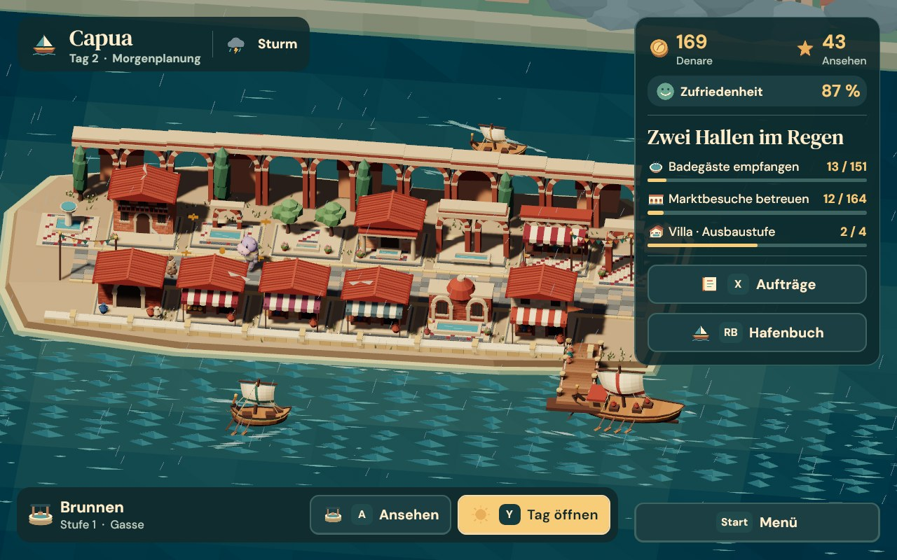
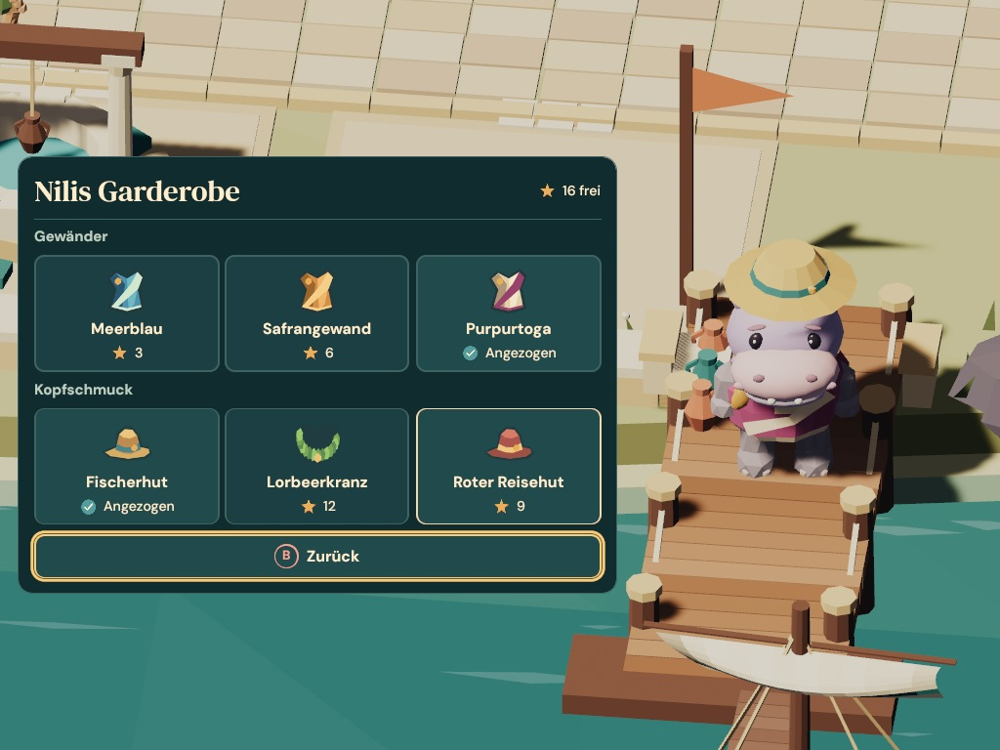
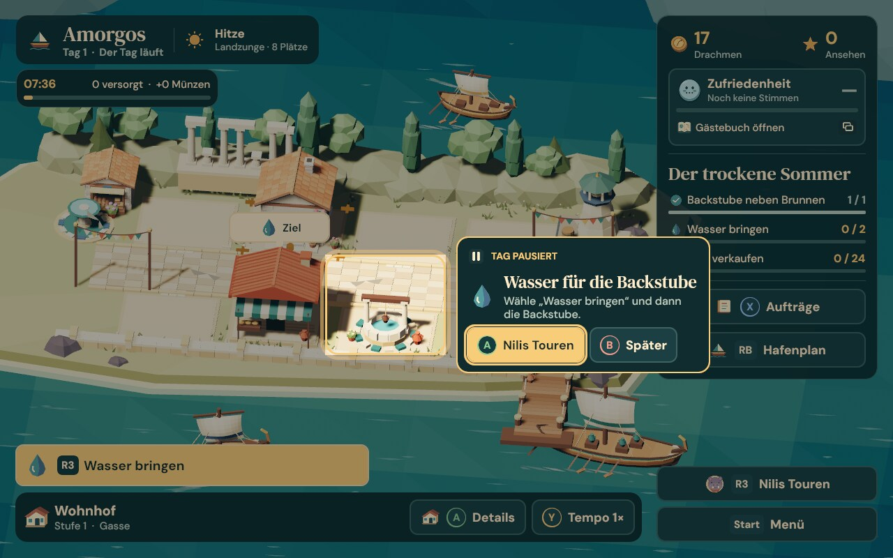

# Nililane 2.4.0

Nililane ist ein 3D-Straßenmanagementspiel in Rust und Bevy. Mit dem Nilpferd Nili
reist du zuerst durch das antike Griechenland und danach durch das antike
Rom. Du planst die Gasse am Morgen, versorgst Nachbarn und Fährgäste und hilfst
tagsüber dort, wo sich die Lieferungen stauen. Auf der Kampagnenkarte erkennst
du die Größe des nächsten Hafens schon vor der Überfahrt.

**[Nililane 2.4.0 für Android herunterladen](https://raw.githubusercontent.com/bthginfo/Nililane/3863cc7e6658183653ff872e5f0297fd6fa06963/Nililane-2.4.0.apk)** · [SHA-256](https://raw.githubusercontent.com/bthginfo/Nililane/3863cc7e6658183653ff872e5f0297fd6fa06963/Nililane-2.4.0.apk.sha256) · [Veröffentlichung](https://github.com/bthginfo/Nililane/releases/tag/v2.4.0)




## Auf dem Tablet spielen

Die signierte APK benötigt Android 8 oder neuer, Vulkan 1.1 und ein Gerät
mit ARM64- oder x86_64-Prozessor. Öffne die APK auf dem Tablet und installiere
sie. Installiere das Update über deine bisherige Version, um deine laufende
Gasse und die Sternrekorde mitzunehmen. Nililane läuft offline und öffnet sich im Querformat.

Kopple den Xbox-Controller über die Android-Bluetooth-Einstellungen oder
schließe ihn per USB an. Unter **Erste Reise** beginnt der bebilderte
Einstieg auf Naxos. Auf den ersten drei Inseln hält der Spieltag an wichtigen
Stellen an. Mit **A** oder einem Tipp auf die Markierung folgst du der Hilfe.
Mit **B** schließt du den Hinweis. Im Haupt- und Pausenmenü findest du die
**Spielhilfe**. In den **Einstellungen** kannst du die Oberfläche vergrößern
sowie Musik und Spielklänge separat schalten.

| Xbox-Controller | Aktion |
| --- | --- |
| Steuerkreuz oder linker Stick | Bauplatz oder Menüaktion wählen, während eines Auftrags Nili bewegen |
| A | Bestätigen, Grundstück öffnen oder am markierten Ort abholen und abgeben |
| B | Zurück, pausieren oder den laufenden Auftrag abbrechen |
| X | Aufträge ansehen |
| Y | Tag starten, das Tempo wechseln oder auf der Kampagnenkarte das Tutorial neu starten |
| RB | Hafenplan mit Wetter, Nachfrage und Vorräten öffnen |
| View (Taste mit zwei Rechtecken) | Gästebuch direkt öffnen |
| Rechten Stick drücken (R3) | Ab Amorgos Nilis Touren öffnen |
| Rechter Stick, LT und RT | Kamera schwenken und zoomen |
| LB | Kamera zurücksetzen |
| Start | Pausenmenü öffnen |

Tippe ein Gebäude an, um seinen Bedarf zu sehen. Bewege Nili während eines
Auftrags mit dem runden Steuerfeld und tippe am Ziel auf die helle Aktion.
Mit der Tastatur bedienen
Pfeiltasten oder WASD die Auswahl, Enter bestätigt, Escape geht zurück.
X, Y, P, Q und E entsprechen X, Y, Start, LB und RB. N öffnet Nilis Touren.
F öffnet das Gästebuch.

## Neu in 2.4.0

- **Nili selbst steuern.** Mit linkem Stick oder Touch zum markierten Ort
  gehen und dort abholen oder abgeben. Die Hafenuhr pausiert während der
  Steuerung. Beim Abschluss verstreicht die eingeplante Zeit des Auftrags.
- **Bedarf am Gebäude.** Die Details vergleichen Vorrat und erwartete Gäste,
  zeigen knappes Wasser und schlagen verfügbare Touren vor.
- **Zwischenfälle am Hafen.** Ab Rhodos können ein kleiner Ofenbrand oder
  verrutschte Kisten nach Unwetter einen Hafenauftrag auslösen.
- **Drei Altersgruppen.** Kinder, Erwachsene und ältere Gäste haben
  eigene Körperformen und Laufbewegungen. Backstuben, Tavernen und
  Töpfereien können morgens eine Spezialität für eine Gruppe wählen.
  Wer sie mag und einkauft, bringt zusätzliches Ansehen.
- **Nilis Garderobe.** Auf der Kampagnenkarte und im Pausenmenü kannst du
  mit verdienten Sternen drei Gewänder und drei Kopfbedeckungen kaufen.
  Kombiniere ein Gewand mit einer Kopfbedeckung. Sternrekorde und
  Freischaltungen bleiben erhalten.



## Neu in 2.3.2

- Die Kamera im Startmenü steht ruhig. Android glättet die Kanten der
  3D-Szene, die Bildausgabe ist mit dem Display synchronisiert, und Schaum
  und Kielwasser zeichnen sich auf getrennten Ebenen ab.
- Mit **Tutorial neu starten** oder **Y** auf der Kampagnenkarte wiederholst
  du die Übungen auf Naxos, Amorgos und Delos. Die Übungsreise speichert
  separat. Über **Übung beenden** gelangst du zurück zur Kampagnenkarte.
  Dein bisheriger Hafen und deine Sterne bleiben erhalten.

## Neu in 2.3.1

Die Fähre liegt mit Abstand vor dem Steg. Ein hölzerner Landgang führt
an Bord und bewegt sich mit dem Schiff. Am Liegeplatz ist das Segel
eingeholt, beim Ablegen entfaltet es sich. Die Titelkamera zeigt die Fähre
auch im 4:3-Format vollständig.


## Neu in 2.3

- **Naxos** zeigt den ersten Bauplatz, die Preise, den Tagesstart, die
  anlegende Fähre und die ersten Gästestimmen.
- **Amorgos** führt vom Brunnen zur Backstube. **Delos** zeigt den Platz
  für die Töpferei, die Nachschubtour und den ersten Ausbau.
- Eine helle Markierung zeigt den passenden Ort. Daneben steht ein kurzer
  Hinweis mit einer Aktion. Bei Ereignissen während des Tages pausiert die Uhr.
- Schilder und eine Punktspur zeigen Nilis Abholort und Ziel. Er hebt Kisten,
  füllt und gießt Krüge, winkt Gästen, fächert mit Zweigen und räumt Treibgut.
  Nach der Arbeit zeigt ein Symbol, was am Ziel angekommen ist.
- Hinweise, Aufträge, Gästestimmen und Hafengeschichten sind sprachlich
  überarbeitet. Bei Läden heißt es „Ausverkauft“, bei Betten und Plätzen
  „Belegt“.
- Die Ausbauvorschau markiert knappe Wasserversorgung. Die Kampagnenprüfung
  hat alle 48 Häfen mit drei Sternen abgeschlossen und den Fortschritt
  nach jedem Hafen wieder geladen.



## Neu in 2.2

- Nili markiert den nächsten Schritt auf der Insel. Auf Naxos zeigen Bilder
  die Reihenfolge vom ersten Bauplatz bis zum Tagesstart. Auf Amorgos führt
  Nili vom Brunnen zur ersten Wasserlieferung.
- Die Baukarten zeigen Kosten und Ertrag. In der Preiswahl siehst du für jede
  Stufe, wie viele der erwarteten Gäste genug Geld haben.
- Sprechblasen und Schilder zeigen leere Auslagen, offene Bitten vom Kai und
  mögliche Ziele für Nilis Touren. Die Aufträge erhalten bei Fortschritt
  einen aktualisierten Balken und bei Erfüllung ein Häkchen.
- Die Spielhilfe erklärt Steuerung und Abläufe mit Symbolen und kurzen
  Sätzen. Die Begrüßungen und Tipps aller 48 Häfen sind überarbeitet.


## Neu in 2.1

- Über Gästen erscheinen Gesichter, das Warensymbol und ein kurzer Hinweis.
  Tippe eine Sprechblase an, um die Rückmeldung im Gästebuch zu öffnen.
- Die Zufriedenheitskarte zeigt die Anzahl erfüllter Wünsche und die letzte
  Stimme. Im Gästebuch lassen sich Nachbarn und Fährgäste vergleichen und
  Preisprobleme, leere Auslagen, lange Wege und fehlende Angebote filtern.
- Das Gästebuch führt zum betroffenen Laden oder schlägt morgens einen
  erreichbaren Bauplatz vor. Im geöffneten Hafen vergleicht die Vorratsseite
  den restlichen Bestand mit den noch anstehenden Besuchen.
- Nach der Abrechnung bleiben die Gästestimmen für die Morgenplanung erhalten.


## Neu in 2.0

- **Nilis Hafenrunden.** Schick Nili zum Wasserholen, zur Eilfracht, als
  Gästelotse, auf Schattentour oder nach Unwetter zum Treibgutbergen. Wähle
  das Ziel auf der Insel. Nili läuft hin, lädt auf und liefert ab.
- **Neue Aufträge.** Plane Nachschub und Fährbesuche gezielt ein. Je nach Hafen
  zählen bestimmte Touren, verschiedene erledigte Aufgaben, ein guter Fährtag
  oder die Zufriedenheit bei ausreichenden Rückmeldungen.
- **Verschiedene Küsten.** 6 bis 18 Bauplätze auf Buchten, Landzungen,
  Terrassenhäfen und Lagunen. Die Gassen- und Promenadenseiten sind je nach
  Hafen verschieden lang.
- **Sichtbare Ausbauten.** Von Außenöfen und Dachgärten bis zu Badegalerien und
  neuen Aquäduktbögen. Ein kurzes Gerüst mit Staub und Hammerschlägen zeigt
  Neubauten und Ausbauten direkt auf dem Grundstück.
- **Lebendige Gassen.** Griechische und römische Gäste tragen unterschiedliche
  Kleidung, gehen mit animierten Schritten und folgen dem Weg zum Laden.
  Im Gästebuch sagen die Gäste, was sie gefunden oder vermisst haben.

## Die Reise

- **Griechenland** beginnt in Naxos und endet am Hafenrat von Korinth. In
  24 Kapiteln kommen Speicher, Ölpressen und Heiligtümer zu den ersten
  Werkstätten, Höfen und Tavernen hinzu.
- **Rom** schaltet sich nach Griechenland frei. In 24 weiteren Kapiteln
  verbinden Aquädukte, Thermen, Foren und Villen die Gassen von Ostia bis
  Rom. Eigene Bauten, Kleidung, Musik und Schiffe prägen die zweite Reise.
- Die 15 Gebäudetypen lassen sich bis Stufe 4 ausbauen. Für Läden stehen
  drei Preise zur Wahl. Die Ausbauvorschau benennt die sichtbare Erweiterung
  und zeigt, wie sich Wasser, Vorräte und Bewohnerzahlen verändern.
- Im Hafenplan stehen Nachfrage, Vorräte, Zufriedenheit und die Vorhersage
  für drei Tage. Wind, Regen und Sturm beeinflussen die See, den
  Fährverkehr und die Wasserreserven. Mit dem Hafenplan kannst du
  Wasser holen, zusätzliche Fährgäste einladen oder Nachbarn bevorzugen.
- Am Hafen warten drei Aufträge. Ein zügiger Abschluss und Bitten vom Kai bringen
  Zusatzsterne. Nach dem Abschluss kannst du bleiben, weiterreisen
  oder einen Hafen für mehr Sterne erneut besuchen.
- Bauentscheidungen, laufende Tage und Sternrekorde werden lokal gespeichert.
  Bei Normaltempo ist jede Reise inklusive Planung auf rund acht Stunden
  ausgelegt. Dein Bautempo, die Tempo-Taste und Wiederholungen verändern
  die tatsächliche Spielzeit.

## Aus dem Quellcode starten

Mit Rust Stable und auf Linux mit Vulkan, X11, `libudev-dev` und
`libasound2-dev`.

```sh
cargo run --locked
cargo test --locked
```

Zum Paketieren sind JDK 17 oder neuer, Python 3, SDK Platform 36, Build Tools
36.0.0 und NDK r28c erforderlich. Die SDK-Installation muss über
`ANDROID_HOME` oder `ANDROID_SDK_ROOT` erreichbar sein.

```sh
rustup target add aarch64-linux-android x86_64-linux-android
tools/build-android.sh
```

Die APK liegt in `build/android/`. Der Standardbuild erzeugt eine lokal
signierte Test-APK. Für ein Paket mit eigenem Veröffentlichungszertifikat
verwende `NILILANE_KEYSTORE` und `NILILANE_KEY_PASSWORD_FILE` sowie bei
Bedarf `NILILANE_KEY_ALIAS`. Ein Update von `game.nililane` braucht
denselben Signaturschlüssel.

[Asset-Herkunft](assets/QUELLEN.md) · [Tests und Spielreview](docs/Abnahme.md)
