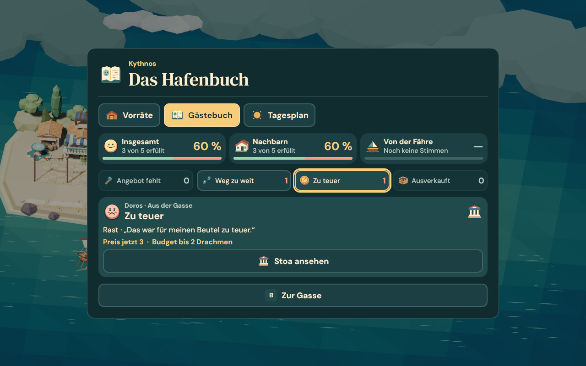

# Nililane 2.1

Nililane ist ein 3D-Straßenmanagementspiel in Rust und Bevy. Mit dem Nilpferd Nili
reist du zuerst durch das antike Griechenland und danach durch das antike
Rom. Du planst die Gasse am Morgen, versorgst Nachbarn und Fährgäste und hilfst
tagsüber dort, wo sich die Lieferungen stauen. Auf der Kampagnenkarte erkennst
du die Größe des nächsten Hafens schon vor der Überfahrt.

**[Nililane 2.1.0 für Android herunterladen](https://raw.githubusercontent.com/bthginfo/Nililane/4e7a819712b6376bcd631aa47c20cffe3f5c5818/Nililane-2.1.0.apk)** · [SHA-256](https://raw.githubusercontent.com/bthginfo/Nililane/4e7a819712b6376bcd631aa47c20cffe3f5c5818/Nililane-2.1.0.apk.sha256) · [Veröffentlichung](https://github.com/bthginfo/Nililane/releases/tag/v2.1.0)


## Auf dem Tablet spielen

Die signierte APK benötigt Android 8 oder neuer, Vulkan 1.1 und ein Gerät
mit ARM64- oder x86_64-Prozessor. Öffne die APK auf dem Tablet und installiere
sie. Installiere das Update über deine bisherige Version, um deine laufende
Gasse und die Sternrekorde mitzunehmen. Nililane läuft offline und öffnet sich im Querformat.

Kopple den Xbox-Controller über die Android-Bluetooth-Einstellungen oder
schließe ihn per USB an. Unter **Erste Reise** führt Nili dich durch den
ersten Bau, die Eröffnung der Gasse und eine Hafenbitte. Im Haupt- und Pausenmenü
gibt es eine bebilderte **Spielhilfe**. Unter **Einstellungen** kannst du
die Oberfläche vergrößern sowie Musik und Spielklänge separat schalten.

| Xbox-Controller | Aktion |
| --- | --- |
| Steuerkreuz oder linker Stick | Bauplatz oder Menüaktion wählen |
| A | Bestätigen, Grundstück öffnen oder Nili helfen lassen |
| B | Zurück, während des Spiels pausieren |
| X | Aufträge ansehen |
| Y | Tag eröffnen, während des Tages zwischen 1× und 2× wechseln |
| RB | Hafenbuch mit Nachfrage und Vorräten öffnen |
| View (Taste mit zwei Rechtecken) | Gästebuch direkt öffnen |
| Rechten Stick drücken (R3) | Ab Amorgos Nilis Touren öffnen |
| Rechter Stick, LT und RT | Kamera schwenken und zoomen |
| LB | Kamera zurücksetzen |
| Start | Pausenmenü öffnen |

Touch und Maus wählen Bauplätze und Schaltflächen. Mit der Tastatur bedienen
Pfeiltasten oder WASD die Auswahl, Enter bestätigt, Escape geht zurück.
X, Y, P, Q und E entsprechen X, Y, Start, LB und RB. N öffnet Nilis Touren.
F öffnet das Gästebuch.

## Neu in 2.1

- Über Gästen erscheinen Gesichter, das Warensymbol und ein kurzer Hinweis.
  Tippe eine Sprechblase an, um die Rückmeldung im Gästebuch zu öffnen.
- Die Zufriedenheitskarte zeigt die Anzahl erfüllter Wünsche und die letzte
  Stimme. Im Gästebuch lassen sich Nachbarn und Fährgäste vergleichen und
  Preisprobleme, leere Auslagen, lange Wege und fehlende Angebote filtern.
- Das Gästebuch führt zum betroffenen Laden oder schlägt morgens einen
  erreichbaren Bauplatz vor. Im geöffneten Hafen vergleicht die Vorratsseite
  den restlichen Bestand mit den noch anstehenden Besuchen.
- Nach der Abrechnung bleiben die Gästestimmen für die Morgenplanung erhalten.



## Neu in 2.0

- **Nilis Hafenrunden.** Schick Nili zum Wasserholen, zur Eilfracht, als
  Gästelotse, auf Schattentour oder nach Unwetter zum Treibgutbergen. Wähle
  das Ziel auf der Insel. Nili läuft hin, lädt auf und liefert ab.
- **Neue Aufträge.** Plane Nachschub und Fährbesuche gezielt ein. Je nach Hafen
  zählen bestimmte Touren, verschiedene erledigte Aufgaben, ein guter Fährtag
  oder die Zufriedenheit bei ausreichenden Rückmeldungen.
- **Verschiedene Küsten.** 6 bis 18 Bauplätze auf Buchten, Landzungen,
  Terrassenhäfen und Lagunen. Die Gassen- und Promenadenseiten sind je nach
  Hafen verschieden lang.
- **Sichtbare Ausbauten.** Von Außenöfen und Dachgärten bis zu Badegalerien und
  neuen Aquäduktbögen. Ein kurzes Gerüst mit Staub und Hammerschlägen zeigt
  Neubauten und Ausbauten direkt auf dem Grundstück.
- **Lebendige Gassen.** Griechische und römische Gäste tragen unterschiedliche
  Kleidung, gehen mit animierten Schritten und folgen dem Weg zum Laden.
  Im Hafenbuch sagen einzelne Gäste, was sie gefunden oder vermisst haben.

## Die Reise

- **Griechenland** beginnt in Naxos und endet am Hafenrat von Korinth. In
  24 Kapiteln kommen Speicher, Ölpressen und Heiligtümer zu den ersten
  Werkstätten, Höfen und Tavernen hinzu.
- **Rom** schaltet sich nach Griechenland frei. In 24 weiteren Kapiteln
  verbinden Aquädukte, Thermen, Foren und Villen die Gassen von Ostia bis
  Rom. Eigene Bauten, Kleidung, Musik und Schiffe prägen die zweite Reise.
- Die 15 Gebäudetypen lassen sich bis Stufe 4 ausbauen. Für Läden stehen
  drei Preise zur Wahl. Die Ausbauvorschau benennt die sichtbare Erweiterung
  und zeigt, wie sich Wasser, Vorräte und Bewohnerzahlen verändern.
- Im Hafenbuch stehen Nachfrage, Vorräte, Zufriedenheit und die Vorhersage
  für drei Tage. Nordwind, Regen und Sturm beeinflussen die See, den
  Fährverkehr und die Wasserreserven. Mit Hafenbeschlüssen kannst du
  Wasser holen, zusätzliche Fährgäste einladen oder Nachbarn bevorzugen.
- Am Hafen warten drei Aufträge. Richttag und Hafenbitten bringen
  Zusatzsterne. Nach dem Abschluss kannst du bleiben, weiterreisen
  oder einen Hafen für mehr Sterne erneut besuchen.
- Bauentscheidungen, laufende Tage und Sternrekorde werden lokal gespeichert.
  Bei Normaltempo ist jede Reise inklusive Planung auf rund acht Stunden
  ausgelegt. Dein Bautempo, die Tempo-Taste und Wiederholungen verändern
  die tatsächliche Spielzeit.

## Aus dem Quellcode starten

Mit Rust Stable und auf Linux mit Vulkan, X11, `libudev-dev` und
`libasound2-dev`.

```sh
cargo run --locked
cargo test --locked
```

Zum Paketieren sind JDK 17 oder neuer, Python 3, SDK Platform 36, Build Tools
36.0.0 und NDK r28c erforderlich. Die SDK-Installation muss über
`ANDROID_HOME` oder `ANDROID_SDK_ROOT` erreichbar sein.

```sh
rustup target add aarch64-linux-android x86_64-linux-android
tools/build-android.sh
```

Die APK liegt in `build/android/`. Der Standardbuild erzeugt eine lokal
signierte Test-APK. Für ein Paket mit eigenem Veröffentlichungszertifikat
verwende `NILILANE_KEYSTORE` und `NILILANE_KEY_PASSWORD_FILE` sowie bei
Bedarf `NILILANE_KEY_ALIAS`. Ein Update von `game.nililane` braucht
denselben Signaturschlüssel.

[Asset-Herkunft](assets/QUELLEN.md) · [Tests und Spielreview](docs/Abnahme.md)
